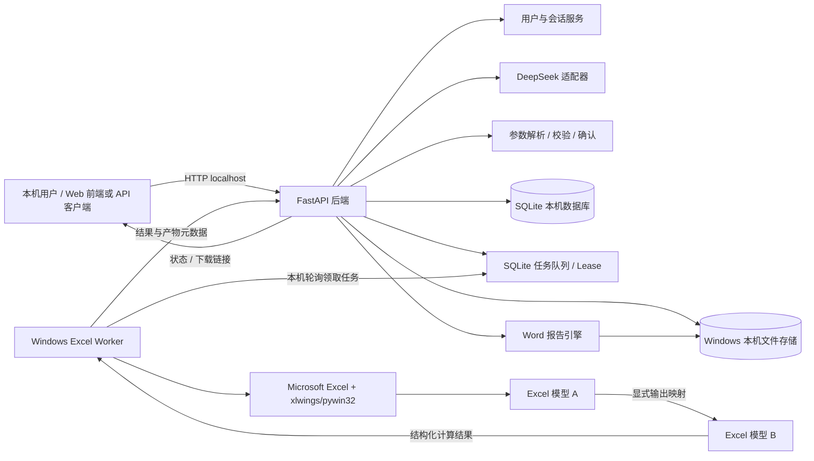
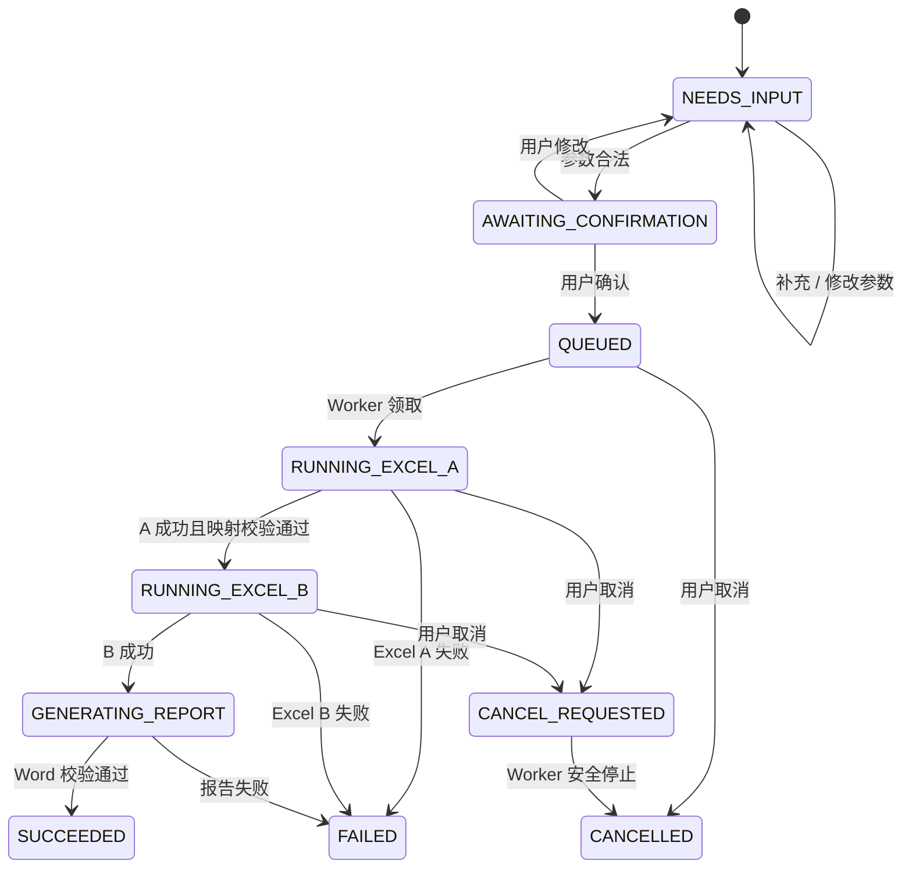

# AI + Excel 智能计算与自动报告系统

## MVP 系统设计方案

> 版本：1.0　　
> 设计依据：项目 MVP 合同草案及工作区现有 Excel 自然语言计算原型。  
> 目标：先交付“自然语言 → 参数确认 → Excel A → Excel B → Word 报告 → 文件下载”的单一、可验收业务闭环；MCP、Agent 编排平台、任意模板适配和企业级多租户尽可能纳入。

---

## 1. 目标与范围

### 1.1 MVP 必须实现

1. 用户以自然语言创建一次计算请求。
2. DeepSeek 将请求解析为**业务参数**结构，不接收或生成 Excel 单元格地址。
3. 后端按模型定义完成类型、单位、范围、必填项和默认值校验；缺参或有歧义时先向用户追问。
4. 用户确认参数后，服务端建立计算任务，Windows Excel Worker 在任务副本上运行 Excel A、将映射结果传入 Excel B、读取约定结果。
5. 后端以计算结果为事实源生成 AI 说明，并将结果和说明填入约定的 Word 模板。
6. 用户可以查看任务状态，在界面右侧预览并下载每本工作簿导出的多页 PDF 和 Word 报告；可编辑 XLS/XLSM 计算副本仅存放在后台私有目录，不通过 API 提供给用户。
7. 会话参数可修改；已确认的用户偏好按约定优先级参与后续参数默认值。
8. 任务、文件和会话以 `user_id`、`session_id`、`job_id`、`model_id` 隔离。

### 1.2 MVP 明确不做
- LLM 直接写入单元格、修改公式、宏或 VBA；LLM 也不决定结果单元格。
- 改写甲方已有 Excel 核心计算逻辑。


---

## 2. 总体架构

本项目采用 **Windows 单机部署 + Windows Excel Worker**，不部署 Linux 服务，也不使用 LibreOffice 或其他非 Excel 计算引擎。API、LLM 适配、任务队列、报告生成和 Excel Worker 均运行在 Windows 环境；Worker 通过本机 SQLite 领取任务，使用安装并授权的 Microsoft Excel 执行所有工作簿。MVP 默认只监听 `127.0.0.1`，避免未经身份认证就向局域网或公网开放。



### 2.1 组件边界

| 组件 | 职责 | MVP 建议实现 |
|---|---|---|
| API / 应用服务 | 会话、任务、权限、状态、下载接口；编排业务用例 | Python、FastAPI、Pydantic |
| LLM 适配器 | 调用 DeepSeek；按 JSON Schema 提取业务参数、生成受控说明 | OpenAI 兼容 API；超时、重试、脱敏日志 |
| 模型定义 | 参数、默认值、单位、校验规则、输入/输出映射、模板版本 | 版本化 YAML/JSON；校验通过后才发布 |
| 参数服务 | 合并偏好、识别缺参、校验、生成确认摘要 | Python 纯业务逻辑，不依赖 LLM |
| Job 服务 | 创建、排队、租约、超时、崩溃重领、状态查询 | SQLite 任务表和租约；不额外引入 PostgreSQL/Redis/Celery |
| Windows Worker | 安全领取任务；复制工作簿；驱动 Excel；收集结果/产物；回报状态 | Windows 登录用户会话中的后台进程；xlwings 驱动本机 Microsoft Excel |
| 报告引擎 | 用结构化结果生成 Word 报告和说明 | MVP 默认使用 `python-docx` 生成报告；收到甲方 Word 模板后再完成具体模板映射 |
| 存储 | 保存模板、任务副本、结果文件、报告及元数据 | SQLite + Windows 本机私有目录 |

**部署约束：**FastAPI 与 Worker 可作为两个进程运行在同一台 Windows 主机上，共用本地数据库和存储目录。Microsoft Excel COM 自动化必须在已登录的 Windows 用户会话中运行，不将 Excel COM 当作 Linux 服务、Windows 服务或无交互服务器组件使用。未来如需远程多用户访问，须先增加可靠认证、授权和安全传输；不通过简单开放端口实现。

---

## 3. 端到端业务流程

### 3.1 参数收集与确认

1. 客户端以 `user_id`、`session_id` 和自然语言消息调用对话接口。
2. 后端读取当前模型定义、当前会话参数及允许使用的用户偏好。
3. DeepSeek 只输出 `model_id` 候选、业务字段值、字段来源/置信信息、缺失字段和澄清问题；不得接收任意路径、Sheet 名、Cell 地址或执行权限。
4. Pydantic/业务规则层进行确定性校验：字段白名单、类型、单位转换、枚举、范围、跨字段约束。
5. 有必填项缺失、非法值、模型选择歧义或置信度不足时，返回澄清问题；不创建 Excel 任务。
6. 后端生成参数摘要供用户确认。用户改动参数时重新校验；明确确认后才创建 `job_id`。

参数来源优先级：

> 用户本轮明确输入 ＞ 当前会话中已确认参数 ＞ 用户模型偏好 ＞ 用户全局偏好 ＞ 模型默认值

若偏好与用户本轮明确输入冲突，以本轮输入为准。长期偏好只在用户明确要求“以后默认”等场景并完成确认后保存。

### 3.2 计算与报告

1. 后端锁定模型定义、模板、映射及 Prompt 的版本，生成不可变 `CalculationSnapshot`。
2. 后端创建任务并排队；任务初始状态为 `QUEUED`。
3. Worker 以租约领取任务，下载或读取任务所需模板，在任务隔离目录复制 Excel A/B。模板文件始终只读，不对原模板就地写入。
4. Worker 按映射写入 A 的输入、执行全簿重算并读取白名单输出。
5. 只有 A 成功且输出校验通过，才将指定输出映射到 B 的业务输入并继续计算。
6. Worker 检查计算错误值、空值、非有限数值及必要业务不变量；原始计算副本保存到后台私有目录，并由 Microsoft Excel 将每本工作簿导出为多页 PDF。
7. 后端持久化结构化结果，以这些数据为唯一事实源调用 DeepSeek 生成说明。说明仅能引用已提供数值；数值无法由结果数据核验时不写入报告。
8. Word 报告引擎填充固定版本模板，保存 `.docx`，校验文件可打开且必填占位符已替换。
9. 任务进入 `SUCCEEDED` 后，用户只取得 PDF/Word 的预览和下载授权；XLS/XLSM 不登记为公开产物。任一阶段失败则进入 `FAILED`，保留可诊断错误码，不发布不完整报告。

### 3.3 状态机



任务状态更新需记录时间、阶段、错误码和 Worker 标识；不把大文件或完整敏感输入写进普通应用日志。

---

## 4. 配置与数据契约

### 4.1 模型定义（示意）

模型定义是唯一可信的参数与单元格映射来源。以下只是结构示例，实际字段、工作表及单元格须在分析甲方模板后确定：

```yaml
model_id: sample-model
version: 1
excel_engine: microsoft_excel
workbooks:
  - id: model_a
    template_id: model-a-template-v1
    inputs:
      - parameter: principal
        sheet: 输入
        cell: B2
        type: decimal
        unit: CNY
        required: true
        min: 0
      - parameter: annual_rate
        sheet: 输入
        cell: B3
        type: decimal
        unit: percent
        required: true
        min: 0
        max: 1
    outputs:
      - name: annual_payment
        sheet: 结果
        cell: D8
        type: decimal
        unit: CNY
        required: true
  - id: model_b
    template_id: model-b-template-v1
    inputs:
      - parameter: source_annual_payment
        sheet: 参数
        cell: C4
        type: decimal
        unit: CNY
        required: true
    outputs:
      - name: final_value
        sheet: 结果
        cell: F12
        type: decimal
        unit: CNY
        required: true
handoffs:
  - from: model_a.annual_payment
    to: model_b.source_annual_payment
report_template_id: report-v1
result_fields:
  - model_a.annual_payment
  - model_b.final_value
```

校验规则：

- 用户和 LLM 只能提供诸如 `principal`、`annual_rate` 的业务字段；单元格映射只能由服务端模型定义读取。
- 部署时校验所有映射的工作簿、工作表、地址和字段类型；运行时重复验证模板版本和目标地址。
- 不允许模型定义引用未登记的模板路径；文件 ID 在存储层解析为内部路径。
- 每次任务快照固定模型定义和模板的版本/哈希，确保可复现和审计。

### 4.2 参数解析输出（示意）

```json
{
  "model_id": "sample-model",
  "parameters": {
    "principal": {"value": 1000000, "unit": "CNY", "source": "user"},
    "annual_rate": {"value": 0.045, "unit": "percent", "source": "user"}
  },
  "missing_required": [],
  "clarification_questions": []
}
```

后端必须再次校验该对象。不得把 LLM 返回的 `source`、置信度或“已经确认”等标记视为授权；确认动作必须来自用户 API 请求。

### 4.3 任务结果（示意）

```json
{
  "job_id": "uuid",
  "model_id": "sample-model",
  "model_version": 1,
  "status": "SUCCEEDED",
  "results": {
    "model_a.annual_payment": {"value": 76000.25, "unit": "CNY"},
    "model_b.final_value": {"value": 1835000.0, "unit": "CNY"}
  },
  "artifacts": [
    {"type": "pdf", "name": "calculation-result.pdf"},
    {"type": "pdf", "name": "air_preheater-result.pdf"},
    {"type": "word", "name": "calculation-report.docx"}
  ]
}
```

API 响应返回受权限控制的下载接口或短期签名链接，不暴露服务器文件系统路径。

---

## 5. API 设计（MVP）

所有用户接口使用认证身份确定 `user_id`；客户端不能通过任意传入其他 `user_id` 访问资源。Worker API 使用独立服务身份/凭据。

| 方法 | 路径 | 用途 |
|---|---|---|
| `POST` | `/api/v1/sessions` | 创建会话并指定可用模型 |
| `POST` | `/api/v1/sessions/{session_id}/messages` | 提交自然语言消息，返回参数草案、澄清问题或确认摘要 |
| `POST` | `/api/v1/sessions/{session_id}/confirm` | 用户确认已校验参数并创建计算任务 |
| `GET` | `/api/v1/jobs/{job_id}` | 查询任务状态、进度、结构化结果摘要 |
| `POST` | `/api/v1/jobs/{job_id}/cancel` | 请求取消任务 |
| `GET` | `/api/v1/jobs/{job_id}/artifacts/{artifact_id}` | 鉴权后下载 PDF/Word；PDF 支持 inline 预览 |
| `GET/PUT` | `/api/v1/preferences` | 查询/更新用户全局或模型偏好 |

Worker 与 API 在同一 Windows 主机运行，通过 SQLite 本机任务表领取和更新任务，不暴露 Worker HTTP 端点。用户 API 默认只监听 `127.0.0.1`；当前 `X-User-ID` 只是逻辑隔离标识，不是登录认证。

---

## 6. 存储模型

MVP 使用 SQLite 保存以下逻辑实体（单机本地部署；如未来迁移数据库，保持业务接口不变）：

- 用户身份：当前 MVP 在记录中保存 `user_id`，本机开发模式不提供账号认证。
- `sessions`：归属用户、模型、活动状态及更新时间。
- `messages`：会话消息、消息类型、脱敏后的内容/引用；配置合理保留期。
- `session_parameters`：会话当前参数、来源、是否确认、更新时间。
- `preferences`：用户、作用域（全局/模型）、键值、更新时间及明确同意记录。
- `model_definitions`：模型 ID、版本、配置 JSON、发布状态、哈希。
- `jobs`：用户/会话、模型快照、状态、阶段、幂等键、租约/重试次数、错误码、时间戳。
- `job_results`：结构化结果、单位、来源映射及校验状态。
- `artifacts`：只登记用户可访问的 PDF/Word；XLS/XLSM 计算副本保存在独立私有目录，不作为可下载 artifact 登记。
- `audit_events`：用户确认、模型版本、计算开始/结束、下载和偏好变更等关键事件。

PDF/Word 使用 API 管控的产物目录；可编辑 XLS/XLSM 存放在独立的后台私有目录，不挂载为静态资源、不出现在任务 artifact 响应中，下载路由拒绝旧版本遗留的 Excel artifact。设置保留/删除策略；任务过期后清理私有输入/计算副本和对外产物，保留期限由甲方确认。

---

## 7. Excel Worker 设计

### 7.1 执行规则

- 仅使用 Windows 上安装的 Microsoft Excel 执行所有工作簿；不支持 LibreOffice 或其他计算引擎，也不进行失败回退。
- 含 VBA、UDF、XLL、COM Add-in、外链或特定 Excel 函数的模板，必须在实际 Worker 主机上完成兼容性验证，并配置相应的 Excel 信任位置/加载项。
- 一个 Excel 实例/Worker 进程串行处理任务；MVP 不在同一 Excel COM 实例上并行操作。若要扩并发，增加独立 Worker 进程/机器并做容量测试。
- 为每个任务建立独立临时目录和工作簿副本；关闭事件、屏幕更新及告警（不改变业务逻辑），设置打开/计算超时和异常回收。
- 明确计算模式（全簿重算）、宏策略、外部链接策略、只读/受信任目录及输出文件策略；宏默认不启用，只有经过安全审查且模板确需宏时才配置允许列表。
- Excel A 输出传递给 B 前执行数据类型、单位、空值和范围校验；报告生成后产物不可再被同一任务覆盖。
- 任务执行要能识别 Excel 错误值、公式未计算/缓存值缺失、工作簿损坏、受保护工作表和插件不可用，并返回稳定错误码。

### 7.2 Worker 任务协议

领取任务后收到最小化任务清单：`job_id`、模板版本/下载授权、模型定义快照、已确认业务参数、期望结果字段、超时及幂等信息。Worker 只按这份快照执行，不访问 LLM、不自行推断参数，也不接受用户提供的任意文件路径。

Worker 提交：`job_id`、`worker_id`、模板/模型版本、结构化结果、结果校验摘要、产物上传 ID、耗时和安全错误信息。服务端检查租约、任务状态和结果 schema 后才接受完成回报。

---

## 8. Word 自动报告

报告采用固定模板和受控字段映射，建议约定以下占位内容：

- 基础信息：报告标题、编号、日期、模型版本、用户/项目标识（只含业务必要信息）。
- 参数摘要：使用最终确认后的参数和单位。
- 计算结果表：从结构化 Excel 输出填入，数值/单位和保留位数由字段配置决定。
- AI 分析说明：从已校验结果生成；提示词要求只陈述输入结果能支持的内容，不得补造预测、依据或保证。
- 限制声明：计算依赖的模板/规则版本及人工复核提示。

Word 生成后验证必填字段已替换、表格行数正确、文件可重新打开。模板用例若依赖复杂页眉页脚、域、图表或特殊格式，先做原型验证再确定 `python-docx` 是否足够；不预先承诺所有 Word 特性。

---

## 9. 安全、隐私与可靠性

1. **密钥**：DeepSeek/API/Worker 凭据放环境变量或密钥管理服务，不提交到 Git、不保存在普通配置文件；若曾提交过真实密钥，立即轮换并清理历史风险。
2. **文件权限**：认证、归属校验、私有存储、短期下载授权；拒绝任意路径、路径穿越、未登记模板和非允许扩展名。
3. **最小权限**：Worker 账号只访问模板/任务/产物目录；不以管理员运行；宏默认关闭。
4. **LLM 边界**：Prompt 注入/模型幻觉不能越过参数 schema 和校验层；工具调用只触发内部已授权的业务动作。LLM 解释和用户文本作为不可信输入处理。
5. **数据最小化**：向 DeepSeek 仅发送参数整理或结果解释必要内容；发送前去掉身份标识、文件内容和无关敏感字段。部署前由甲方确认数据出境/第三方 API 合规性。
6. **任务可靠性**：Worker 租约、心跳、幂等提交、明确最大重试次数；Excel 计算不是任意重试，重试前重新创建任务副本并避免重复发布文件。
7. **错误处理**：区分用户输入错误、模型定义错误、Excel 失败、Worker 离线、LLM 不可用、报告失败及存储失败；用户端展示可行动提示，内部保留安全诊断。
8. **审计**：记录谁在何时确认了哪一版模型/参数、任务结果摘要和产物哈希；不记录密钥或完整敏感内容。
9. **备份/恢复**：数据库和文件对象按部署环境设置备份；对模板发布和模型配置保留版本，能够回滚。

---

## 10. 现有原型与目标系统的演进

工作区当前原型已覆盖部分自然语言工具调用及 Excel 读写/重算能力，可复用其中的 Excel 引擎思路，但不得将 CLI 原型直接作为多用户服务上线。实施时建议先抽取纯计算接口，再逐步建立配置驱动模型映射、任务隔离和 Web/API 边界。

| 当前原型能力 | MVP 演进方向 |
|---|---|
| `excel_nl.py` 的 CLI 对话、工具调用 | 抽取 LLM Adapter 与 Parameter Extraction；增加结构化输出、用户确认和异常分类 |
| `excel_calc.py` 的 Excel/xlwings 路径 | 收敛为 Windows Excel 唯一引擎；配置映射驱动；服务任务始终副本运行 |
| 直接以 Cell 地址作为工具输入 | 移除 LLM 的单元格控制权；业务参数映射由版本化模型定义管理 |
| 默认读取全部公式单元格 | 仅读取显式登记的业务输出，限制结果体积 |
| CLI 内存对话历史 | SQLite 会话与参数状态，按逻辑用户 ID 隔离 |
| 单工作簿计算 | 添加 A→B 显式输出/输入映射及中间校验 |
| 文本回复/可选 Excel 文件 | Word 模板引擎、报告校验及受控下载接口 |
| 依赖本地配置的 API Key | 环境变量/密钥管理；不把密钥写入仓库配置 |

尤其注意：现有原型曾支持 Excel 失败后回退 LibreOffice；本次实现应删除该回退。Excel 不可用、加载项缺失或计算失败时，任务必须明确失败并提示处理，不能更换计算引擎。当前原型的 `inplace` 功能只适合受信任的本地操作，Worker 业务任务应始终基于副本，禁止覆盖共享模板。

---

## 11. 测试与验收设计

### 11.1 测试层次

- **单元测试**：参数优先级、单位换算、必填/范围校验、偏好合并、模型定义加载、结果格式化、状态转换。
- **LLM 契约测试**：有效 JSON、缺参、歧义、非法字段、单位表达、Prompt 注入、API 超时；使用固定 mock 响应保证稳定回归。
- **Excel 金样测试**：甲方提供输入案例和基准结果；真实 Excel Worker 运行 A、B，按双方约定精度/容差逐字段比对；覆盖边界和错误值。
- **端到端测试**：自然语言 → 澄清 → 用户修改 → 确认 → 双工作簿计算 → Word 生成 → 权限下载。
- **隔离/安全测试**：用户间 session/job/artifact 访问隔离、任意路径拒绝、模板不被修改、并发/重复请求、过期下载授权。
- **兼容测试**：约定 Windows、Excel、Office、宏/插件版本；Worker 重启、Excel 崩溃和 API 短暂不可用后的恢复。

### 11.2 验收证据

每项验收用例留存 `case_id`、模型/模板版本、输入参数、Excel 实际结果、基准差异、任务日志 ID、报告产物哈希及通过/失败结论。真实业务模板和基准结果应由甲方提供并确认；模板未具备或业务规则未明确的测试不得被视为系统缺陷。

### 11.3 最小验收用例

1. 完整参数输入并成功产生 A、B 结果和 Word 文件。
2. 缺少必填参数时发起澄清，补齐后再计算。
3. 用户在确认前修改利率，任务使用最终确认值。
4. 范围/类型错误被后端拒绝，不触发 Worker。
5. 用户本轮输入覆盖已保存偏好；用户未提供时依优先级使用偏好/默认值。
6. Excel A 失败时不执行 B、不生成成功报告，并返回错误状态。
7. Excel A 到 B 的映射值、单位和结果与基准一致。
8. Word 结果数值与 Excel 结构化结果一致，AI 说明不改变数值。
9. 同一任务重复提交不产生重复计算或不一致产物。
10. 一个用户不能访问其他用户的会话、任务和文件；原始模板在计算前后哈希不变。

具体数值容差、运行环境、样本数量、任务时限和文件保留期须在模板技术验证后与甲方书面确定。

---

## 12. 16 周交付建议

| 周期 | 交付重点 | 里程碑/退出条件 |
|---|---|---|
| 第 1–2 周 | Windows 主机、Microsoft Excel、Word 模板分析；宏、UDF、插件、外链检查；金样输入/输出；DeepSeek 与真实 Excel 冒烟验证 | Windows/Office 兼容性结论、模型映射草案、技术风险清单、确认的验收数据 |
| 第 3–5 周 | API 基础、LLM 结构化参数提取、schema 校验、缺参追问、会话参数和确认 | 参数测试通过；LLM 无法绕过校验直接触发计算 |
| 第 6–9 周 | Worker/任务状态；Excel A、B、映射传递、输出校验、隔离副本和错误处理 | A→B 金样结果对齐；模板哈希不变；失败可定位 |
| 第 10–11 周 | Word 模板映射、结构化结果填充、AI 说明和文档校验 | Word 样例字段完整，数值与 Excel 结果一致 |
| 第 12–14 周 | 偏好、完整集成、文件隔离、日志/审计、下载 | 完整业务闭环和用户隔离测试通过 |
| 第 15–16 周 | 回归、部署、文档、源代码和配置交付 | 验收记录、部署/使用/API/测试说明及源代码 |

若第 1–2 周发现 Excel 宏、插件、外部依赖或模板质量不满足自动化条件，先书面确认替代方案、专项支持、范围和周期，再进入后续阶段。

---

## 13. 建议代码仓库结构

```text
app/
  api/                 # FastAPI 路由与 API schema
  core/                # 配置、日志、认证、错误码
  services/             # 对话、参数、任务、偏好、报告编排
  llm/                  # DeepSeek 适配器、Prompt、JSON schema
  models/               # ORM 与领域对象
  repositories/         # 数据访问
  worker_client/        # 服务端任务/产物协议
worker/
  runner.py             # Windows Worker 轮询与租约
  excel_executor.py     # Excel 生命周期、计算、结果读取
  artifact_uploader.py  # 产物上传
model_definitions/      # 版本化业务参数、映射和规则
report_templates/       # Word 模板及映射定义
migrations/             # 数据库迁移
 tests/
  unit/ integration/ e2e/ golden/
```

建议在实现中保持领域边界，即使 MVP 初期部署成一个 Python 服务，也不要将 LLM 提示、HTTP 路由、Excel COM 操作和 Word 文件生成混在一个脚本中。API、Worker 和报告引擎均通过有 schema 的数据契约交互。

---

## 14. 开发前必须确认的事项

1. Excel A、B 文件的确切版本、输入/输出单元格和映射关系。
2. 是否使用 VBA、UDF、XLL、COM Add-in、外部 DLL、数据连接、外链、受保护工作表、隐藏名称或特殊函数。
3. 可用于验收的代表性输入及经业务确认的基准结果，数值容差和舍入规则。
4. Windows/Office 版本、许可证、Worker 主机及 Excel 加载项/信任位置配置。
5. Word 模板复杂程度、必须保留的版式、表格/页眉/页脚/图片等要求，是否需要 PDF。
6. 登录/用户来源、用户偏好保存期限、会话/文件保留期和删除要求。
7. DeepSeek API 是否可发送所需业务数据及脱敏要求；API 费用承担方。
8. Windows 主机的部署位置、备份方式、下载方式、是否需要前端界面；如需远程访问，另行确认认证和安全方案。
9. 验收样本数量、运行时限、错误处理范围及质保期。

以上未确认事项属于技术验证/需求澄清，不应由程序自行猜测。

---

## 15. 结论

本系统以确定性参数校验、真实 Excel 计算和显式映射作为可信核心，以 LLM 作为自然语言界面和受控说明生成器。MVP 的首要成功标准不是引入更多 AI 框架，而是在固定的模型和模板范围内，稳定、可追溯地完成：

> **用户输入与确认 → Excel A → Excel B → 结果校验 → Word 报告 → 授权下载**

任何计算数值都必须可追溯到 Excel 实际输出；任何文件都必须绑定用户、任务及模板版本；任何未确认参数都不得启动计算。
