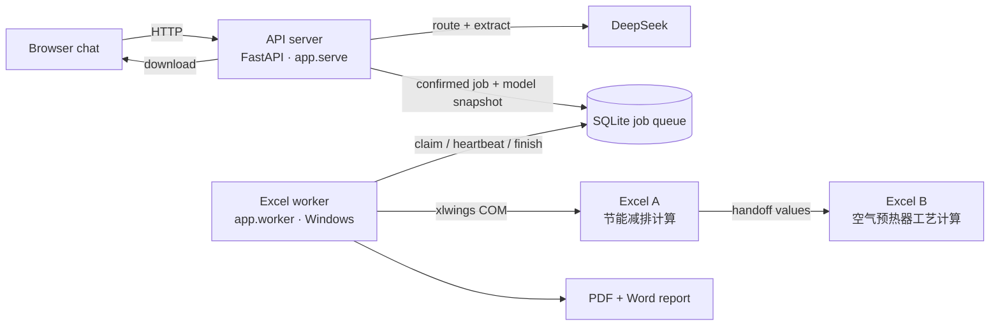

# AI-Excel

An AI + Excel + Word system that turns a plain-language description of an engineering calculation into
real Microsoft Excel results and a generated report.

A user describes the case in a chat, for example *"热负荷 200 MW，燃料气氢气含量 15.3%，目标排烟温度 85 °C"*.
DeepSeek picks the matching calculation model and extracts the parameters. The user confirms them, and a Windows
worker then runs the client's existing Excel workbooks, chains the results from one workbook into the next, and
produces PDF and Word deliverables.

The AI never calculates. Every number comes from Excel; the language model only understands the request and
writes the explanatory text.

## How it works



1. **Chat and routing.** The API sends the message to DeepSeek, which picks a model from the registry and
   extracts its parameters as validated JSON.
2. **Validation and confirmation.** Parameters are checked for type and range, then merged with defaults and
   saved preferences. The user confirms them before anything runs.
3. **Queue.** On confirmation the API stores a job together with a full snapshot of the model definition.
4. **Excel worker.** A separate process on Windows claims the job, writes the inputs into a copy of each
   template, recalculates in real Excel, reads the outputs and passes them to the next workbook.
5. **Report.** The worker exports each workbook to PDF and builds a Word report with an optional AI summary.

The API and the worker only communicate through the job queue, so the API never touches Excel and the worker
never serves HTTP.

## Features

- Natural-language parameter extraction with multi-turn adjustment
- Automatic model selection between several registered calculation models
- Configuration-driven models: parameters, results, workflow steps and cell mappings live in JSON, not code
- Business IDs are separate from Excel cells; sheet and cell addresses appear only in `config/templates/*.json`
- Chained workbooks (Excel A → Excel B) with conditional steps
- Default values, global and per-model user preferences, session parameters
- Lease-based job queue with heartbeats, retries and crash recovery
- PDF export of each workbook and Word report generation (built-in layout or `.docx` template)
- Per-user data isolation, optional HTTP Basic authentication, safe artifact downloads
- Hot reload of model configuration without restarting the API

## Requirements

- Windows 10 or 11 with **Microsoft Excel desktop** installed (Word is needed for the PDF preview of reports)
- Python 3.10 or newer (3.12 or 3.13 recommended; very new Python versions may not have wheels for every pinned package yet)
- A DeepSeek API key
- The Excel workbooks, which are client files and are **not** included in this repository (see [templates/README.md](templates/README.md))

The Excel worker must run in a logged-in Windows desktop session. Office automation does not work from a
Windows service or a session nobody is logged into.

## Getting started

```powershell
git clone https://github.com/amisiespoir-07/AI-Excel.git
cd AI-Excel
python -m venv .venv
.\.venv\Scripts\Activate.ps1
python -m pip install -r requirements.txt
```

If PowerShell blocks the activation script, run `Set-ExecutionPolicy -Scope Process -ExecutionPolicy Bypass` first.

Copy the workbooks into `templates/` with these exact names:

- `节能减排计算.xlsm`
- `空气预热器工艺计算程序.xlsm`

### Run the API (terminal 1)

```powershell
.\.venv\Scripts\Activate.ps1
$secure = Read-Host "DeepSeek API Key" -AsSecureString
$env:DEEPSEEK_API_KEY = [System.Net.NetworkCredential]::new("", $secure).Password
python -m app.serve
```

Open <http://127.0.0.1:8000/> for the chat, or <http://127.0.0.1:8000/health> to check the server.

### Run the Excel worker (terminal 2)

```powershell
.\.venv\Scripts\Activate.ps1
python -m app.worker
```

The DeepSeek key is optional for the worker. Without it, reports use a fixed explanation instead of an AI summary.

### Run the tests

```powershell
python -m pytest
```

The test suite does not need Excel or a DeepSeek key.

## Configuration

All settings are environment variables with sensible defaults.

| Variable | Default | Purpose |
|---|---|---|
| `DEEPSEEK_API_KEY` | (none) | DeepSeek API key |
| `DEEPSEEK_BASE_URL` | `https://api.deepseek.com` | OpenAI-compatible endpoint |
| `DEEPSEEK_MODEL` | `deepseek-chat` | Model name |
| `EXCEL_API_HOST` | `127.0.0.1` | API listen address |
| `EXCEL_API_PORT` | `8000` | API port |
| `EXCEL_API_AUTH` | (none) | `user:password[,user2:password2]` for HTTP Basic auth |
| `EXCEL_DATABASE` | `.runtime/jobs.sqlite3` | Job and session database |
| `EXCEL_TEMPLATE_ROOT` | `templates/` | Folder with the Excel workbooks |
| `EXCEL_MODEL_REGISTRY` | `config/model_registry.json` | List of available models |
| `EXCEL_MODEL_DEFINITIONS_ROOT` | `config/models/` | Model definitions |
| `EXCEL_TEMPLATE_CATALOG` | `config/templates/` | Sheet and cell mappings per workbook |
| `EXCEL_REPORT_TEMPLATE_ROOT` | `templates/reports/` | Optional Word report templates |
| `EXCEL_ARTIFACT_ROOT` | `.runtime/artifacts/` | Generated PDFs and reports |
| `EXCEL_PRIVATE_WORKBOOK_ROOT` | `.runtime/private-workbooks/` | Editable workbook copies (never downloadable) |
| `EXCEL_WORKER_ID` | `win-<computer name>` | Worker identifier |
| `EXCEL_WORKER_POLL_SECONDS` | `1.0` | Queue polling interval |

By default the API only listens on `127.0.0.1`. To open it to other machines, set `EXCEL_API_HOST=0.0.0.0` together
with `EXCEL_API_AUTH`. The server refuses to start on a public address without a password. It does not provide
HTTPS itself, so use a tunnel or reverse proxy for remote access.

## Calculation models

A model is described by three layers of configuration:

| File | Contains |
|---|---|
| `config/model_registry.json` | Which models exist and how the router should recognise them |
| `config/models/<id>/model.json` | Business parameters, results, workflow steps, handoffs and report settings |
| `config/templates/<id>.json` | Where each value lives in a workbook (sheet and cell) |

Two models are included: `model_energy_saving_calc` (Excel A followed by Excel B) and `model_air_preheater`
(Excel B on its own). Adding a parameter, a result or a new workbook is a configuration change. See
[config/README.md](config/README.md) and [扩展指南.md](扩展指南.md).

## API

| Method | Path | Description |
|---|---|---|
| GET | `/health` | Server status |
| GET | `/api/v1/models` | Available models with their parameters and results |
| POST | `/api/v1/sessions` | Start a chat session |
| POST | `/api/v1/sessions/{id}/messages` | Send a message; returns extracted parameters or a question |
| POST | `/api/v1/sessions/{id}/confirm` | Confirm parameters and queue the calculation |
| GET | `/api/v1/jobs/{id}` | Job status, results and files |
| GET | `/api/v1/jobs/{id}/artifacts/{artifact_id}` | Download a PDF or Word file |
| GET, PUT | `/api/v1/preferences` | Read or save default parameter values |

Interactive documentation is available at `/docs` while the API is running.

## Project structure

```
app/
  serve.py            API launcher (checks listen address and password)
  api.py              FastAPI routes and middleware
  service.py          sessions, parameter extraction and confirmation
  model_router.py     chooses a model for a message
  llm.py              DeepSeek client (structured JSON output)
  domain.py           model schema and validation
  model_catalog.py    model registry loader
  model_registry.py   model definition loader with hot reload
  storage.py          SQLite sessions, job queue, preferences, artifacts
  worker.py           Excel worker loop
  workflow.py         runs workflow steps and handoffs
  executors.py        executor registry for step types
  excel_executor.py   Excel automation through xlwings
  reporting.py        Word report and PDF preview
  static/             chat interface
config/               model registry, model definitions, cell mappings
templates/            place the Excel workbooks here (not tracked)
tests/                pytest suite
```

## Documentation (Chinese)

- [AI+Excel智能计算与自动报告系统-设计方案.md](AI+Excel智能计算与自动报告系统-设计方案.md): system design
- [Windows快速使用教程.md](Windows快速使用教程.md): Windows setup guide
- [扩展指南.md](扩展指南.md): extending models, workbooks and reports
- [Startup.md](Startup.md): startup commands

## License

[MIT](LICENSE)
